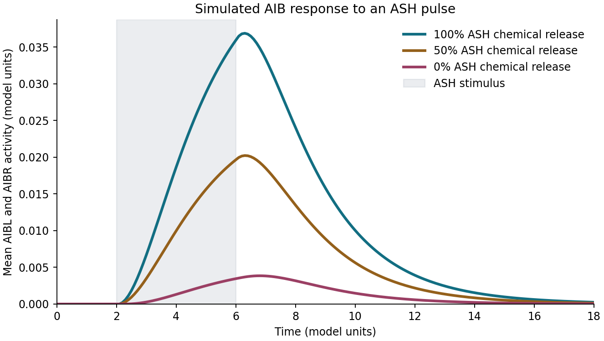

# C. elegans connectome smoke test

This single-node NeuroWorkflow example loads the released ConnectomeGPT-Worm RealIO language-model checkpoint (seed 1337, training step 10,000). It reconstructs the fixed wiring matrix from the OpenWorm hermaphrodite edge list and checks the normalized weights entry by entry. The graph includes muscle and other non-neuronal targets.

The test uses the model definitions from the author's notebook and loads the checkpoint strictly. It supplies two GPT-2 token IDs, checks the next-token logits and loss, and repeats inference with the wiring matrix set to zero. The change in logits measures whether this forward pass depends on the matrix. Biological prediction accuracy and the benefit of the anatomical wiring require separate evaluations.

## Reproduce

Run from this directory with curl and uv. The checkpoint download is 341 MB. The first run also downloads the Python dependencies.

```sh
worm_cache="${XDG_CACHE_HOME:-$HOME/.cache}/connectome-gpt-worm/a00753a"
mkdir -p "$worm_cache"
release=https://huggingface.co/drmylesgarveylabs/connectome-gpt-worm/resolve/a00753aeb87c0bee70b57c81f071b003369138df
curl -fL --retry 2 "$release/experiment_pipelines/experiment_000/01_worm_experiments_final_sheet_%28runnable%29%20%281%29.ipynb" -o "$worm_cache/model.ipynb"
curl -fL --retry 2 "$release/checkpoints/exp1_real_io_seed1337_step010000.pt" -o "$worm_cache/checkpoint.pt"
curl -fL --retry 2 https://raw.githubusercontent.com/openworm/CElegansNeuroML/1ca08b14f4e795a973ce447565e0c97b897ee4dc/herm_full_edgelist.csv -o "$worm_cache/edges.csv"
uv run --no-project --python 3.13 --with torch==2.13.0 --with numpy==2.4.6 --with ../.. python workflow.py "$worm_cache"
```

The script verifies the SHA-256 of each input and prints JSON after all checks pass. The recorded run is in [result.json](result.json).

## GPU simulation of reduced ASH chemical release

This example uses the 448-node OpenWorm anatomy in a recurrent activity model. It drives ASHL and ASHR equally from time 2 to 6 and records the mean of AIBL and AIBR. Figure 6g of the cooling study reports a reduced AIB calcium response in whole-animal *eat-4* mutants and tests rescue of *eat-4* in ASH. The simulation uses an idealized input pulse and a cell-specific release perturbation. [Primary experiment](https://doi.org/10.1038/s41467-023-44638-5)

For each target, the model divides incoming anatomical weights by its total incoming weight before applying any perturbation. Chemical connections transmit positive activity, electrical connections couple activity differences using symmetrized weights, and each node has a unit leak. The update uses forward Euler with a 0.1 step and a saturating tanh on the summed input. The node scales all chemical output from ASH to 100%, 50%, or 0% as a proxy for retained glutamate release. All electrical coupling and other chemical connections remain active. The simulation does not model transmitter-specific receptors, cotransmission, gene expression, developmental compensation, or calcium fluorescence. The previous language-model checkpoint is independent of this simulation.

At gain 0.8, peak bilateral AIB activity was 0.03689, 0.02023 and 0.00385 model units at 100%, 50% and 0% release. The response decreased at gains 0.4 and 1.2 as well. Because ASH has positive modeled chemical connections to AIB, attenuating these connections favors a decrease by construction. The percentages are conditional model effects. A quantitative comparison with the cooling experiment would require calibrated dynamics and matched stimuli.



Run from this directory using the cached edge list from the smoke test. CUDA or Apple Metal is required. A CPU reference checks every saved AIB time point for all nine configurations. The JSON contains all traces, the software version and the numerical discrepancy.

```sh
uv run --no-project --python 3.13 --with torch==2.13.0 --with ../.. python eat4_simulation.py "$worm_cache/edges.csv" eat4_result.json
uv run --no-project --python 3.13 --with matplotlib python plot_eat4.py
```

### Interactive viewer

Open `viewer.html` in a browser from the checkout. Keep `viewer_data.js` beside it. Press Play or drag the time slider to replay GPU node activity. Switch to Full connectome to inspect all 448 cells and their anatomical connections. The wiring stays fixed across release conditions. Node colors show simulated activity on a shared logarithmic scale, and the chart uses the original bilateral AIB values. The circuit view shows only direct connections among the four displayed neurons.

To regenerate the display data with PyTorch, NumPy and NetworkX 3.5 or later installed, run `python build_viewer_data.py "$worm_cache/edges.csv"` in the NeuroWorkflow environment. It checks the bilateral readout against the recorded result before writing.
